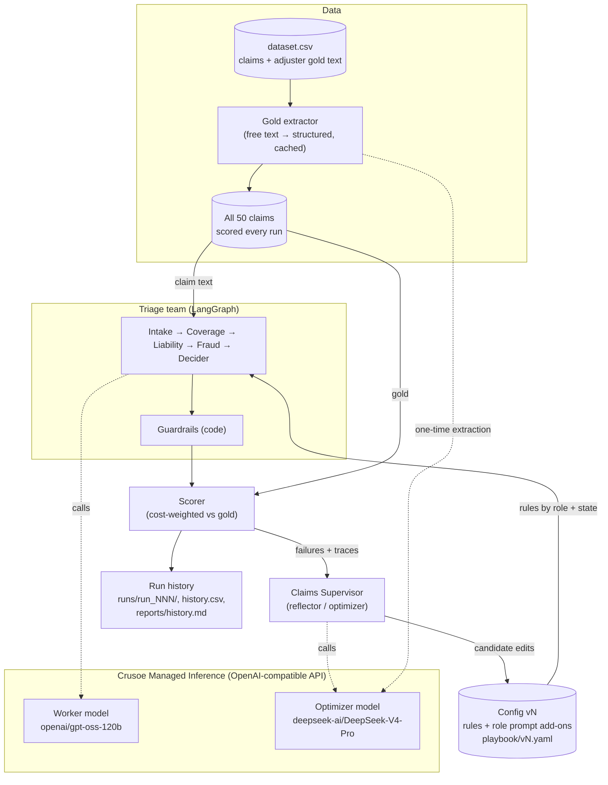
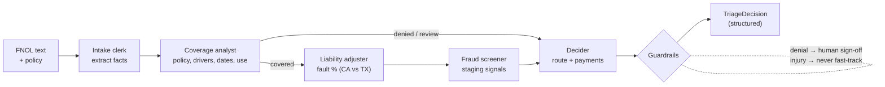
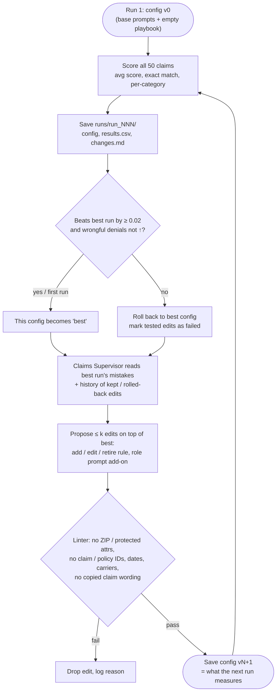
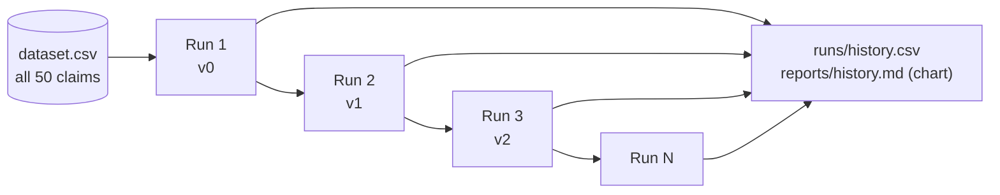

# Architecture: Version N+1 motor claims triage team

Status: **built** (`triage/` package; see [README.md](README.md)). The gold answers come from `data/dataset.csv` (adjusters' decisions). There is **no train/validation/test split**: every run scores all rows, and the improvement shows run over run. The open decisions are listed at the end.

**Goal:** an agent team on Crusoe Managed Inference that triages rear-end auto claims (see [plan.md](plan.md)). After each run it reviews its mistakes against the adjusters' decisions and rewrites its own playbook and prompt add-ons. A change is kept only if the next run scores better; otherwise it's rolled back. The result is a run 1, 2, 3 … improvement curve on the full dataset.

## 1. System overview

## 2. Triage team (one claim)

Each agent's prompt is **fixed base prompt + the role's prompt add-on + the playbook rules for its role and the claim's state**. Every agent cites the rule IDs it used. Only the add-ons and rules change between runs, so every diff is small, readable and easy to roll back.

**Output (`TriageDecision`):** coverage · fault % · pay other party · pay own vehicle · deductible applies · route (fast-track / adjuster / SIU / subrogation / coverage review / deny) · SIU referral · subrogation · human sign-off · rationale · rules cited.

## 3. Run-by-run improvement (the Version N+1 engine)

One run = one full pass over **all 50 claims**. Edits proposed after run N are measured by run N+1 ("apply, then measure").

Overreach shows up as a rollback. For example, "deny every delivery-app claim" makes the next run wrongly deny the drivers who have the endorsement. The score falls and wrongful denials rise, so the config rolls back and the supervisor sees that edit marked as failed.

**What can change between runs:**

| Lever | Where | Example |
|---|---|---|
| House rules | `rules` in `playbook/vN.yaml` | "Deny if the driver is a signed excluded driver" → coverage |
| Role prompt add-ons | `role_instructions` in `playbook/vN.yaml` | "Compare the cancellation date with the grace period" → coverage |
| Retire / edit a rule | same | Retire an overreaching rule |
| Team structure | not yet | e.g. run Fraud only on injury claims |

## 4. Evaluation design

**Same data every run.** All 50 claims are scored in every run, so runs are directly comparable and the curve shows how well the team has learned this claims manual.

**Keeping it honest without a split:**
- **Generality linter:** a rule can't name claim numbers, policy numbers, dates or carriers, or copy 8+ words of a claim description. Rules have to be patterns, not memorized answers.
- **Noise bar:** LLM outputs vary between runs. A run is kept only if it beats the best by at least **0.02** (`--threshold`).
- **Fresh-claims check:** when new rows are added toward 2,000, score `v0` and the best config on only the new rows with `triage eval`. That gives a held-out result as the dataset grows.

**Charted per run:** average cost-weighted score and exact-match rate. Wrongful denials are tracked separately and must not rise.

**Cost-weighted penalty per claim** (weights from plan.md):

| Mistake | Weight |
|---|---|
| Wrongful denial | 10 |
| Missed fraud / wrongful payment | 5 |
| Injury sent to fast-track | 3 |
| Missed subrogation | 2 |
| Wrong fault %, wrong deductible, wrong route | 1 |
| Simple claim over-escalated | 1 |

Each claim's score = 1 − penalty / max penalty. This fills the `evaluation` column, for example 60% or 70%. The version-level report has:

- cost-weighted score
- exact-match rate
- wrongful denials (must stay 0)
- straight-through rate
- SIU hit rate
- subrogation caught
- Crusoe tokens and cost

## 5. Component responsibilities

| Component | Responsibility | Tech |
|---|---|---|
| Inference client | Worker and optimizer models | `langchain-openai` `ChatOpenAI` → Crusoe base URL |
| Triage team | 5 role agents, structured output | LangGraph `StateGraph`, Pydantic |
| Config (playbook) | Plain-English rules + role prompt add-ons, versioned, rollback | YAML (`playbook/vN.yaml`) |
| Guardrails | Sign-off on denials, injury to human, rule linter (protected attrs + generality) | Plain Python (deterministic) |
| Dataset | `dataset.csv` rows → claims; all rows every run | Python (`triage/dataset.py`) |
| Gold extractor | Adjuster's free-text decision → structured gold, cached in `data/gold_structured.jsonl` for review | Optimizer model, one time (`triage/gold.py`) |
| Scorer | Cost-weighted score, reports | Plain Python |
| Supervisor | Reflect on failures, propose edits | Optimizer model |
| Runs | Score all → keep or roll back → propose next config; history and chart | Python (`triage/runs.py`) |

## 6. Where Crusoe fits

- Serves **every model call**: the 5 agents per claim, the supervisor, and the one-time gold extraction.
- Every run is **inference-heavy**: 50 claims × 3–5 agent calls, about 200 calls per run, plus one supervisor call. Cheap, fast open-model inference is what makes many runs affordable.
- Two model tiers (a small worker and a strong optimizer) give a **score-per-dollar** story.

## 7. Open decisions

1. **Policyholder side:** always the rear driver, or either car (adds subrogation)?
2. **States:** CA + TX only (both at-fault), or add a no-fault state?
3. **Claim inputs:** FNOL text + policy only, or also a police report and repair estimate?
4. **What the loop may change:** ~~open~~ decided: rules + role prompt add-ons (base prompts fixed). Still open: tools and team topology.
5. **Gold labels:** ~~oracle~~ decided: `dataset.csv` (extended to ~2,000 rows) is the answer key. Still open: add structured gold columns to the CSV directly, or keep the LLM extraction + human review of `gold_structured.jsonl`?
6. **Models on Crusoe:** ~~open~~ decided: `openai/gpt-oss-120b` (worker), `deepseek-ai/DeepSeek-V4-Pro` (optimizer).
7. **Tracing:** local JSONL, or LangSmith / Langfuse?
8. **Acceptance gate:** ~~open~~ decided: beat the best run by ≥ 0.02, wrongful denials not up, fully automatic. Still open: score each config twice to reduce noise; human approval of `changes.md` between runs.
9. **Demo surface:** CLI report, HTML scorecard, or a UI showing the playbook diffs.
