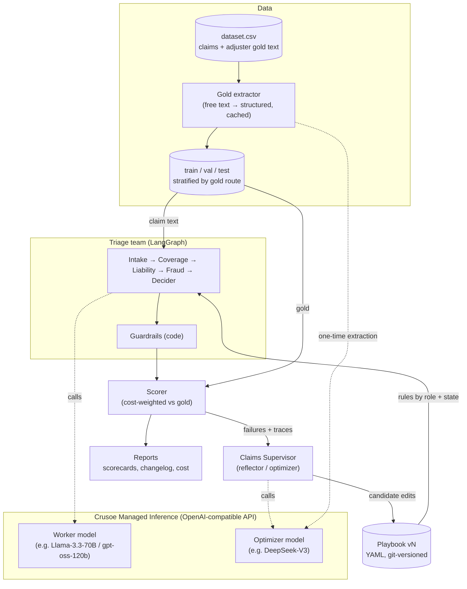
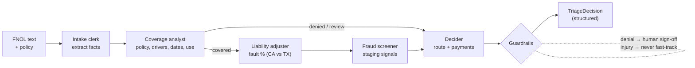
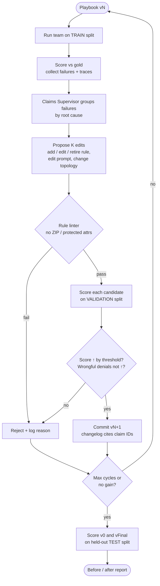
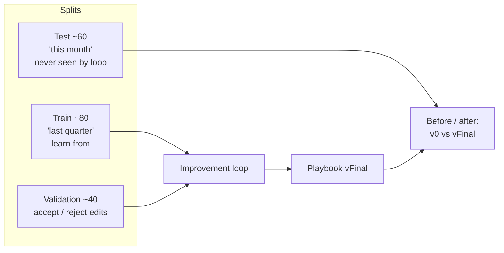

# Architecture: Version N+1 motor claims triage team

Status: **basic version built** (`triage/` package; see [README.md](README.md)). The gold answers come from `data/dataset.csv` (adjusters' decisions), not from an Oracle. The open decisions are listed at the end.

**Goal:** an agent team on Crusoe Managed Inference that triages rear-end auto claims (see [plan.md](plan.md)). After each run it reviews its mistakes against adjusters' decisions and rewrites its own playbook. It keeps a change only if a measured score improves, and it proves the gain with a before-and-after score on claims it has never seen.

## 1. System overview

## 2. Triage team (one claim)

Each agent's prompt is **base prompt + the playbook rules for its role and the claim's state**. Every agent cites the rule IDs it used.

**Output (`TriageDecision`):** coverage · fault % · pay other party · pay own vehicle · deductible applies · route (fast-track / adjuster / SIU / subrogation / coverage review / deny) · SIU referral · subrogation · human sign-off · rationale · rules cited.

## 3. Improvement loop (the Version N+1 engine)

Overreach shows up as a rejection. For example, "always deny delivery-app claims" scores worse on validation because of the drivers who have the endorsement, so the loop drops it.

## 4. Evaluation design

**Cost-weighted penalty per claim** (weights from plan.md):

| Mistake | Weight |
|---|---|
| Wrongful denial | 10 |
| Missed fraud / wrongful payment | 5 |
| Injury sent to fast-track | 3 |
| Missed subrogation | 2 |
| Wrong fault %, wrong deductible, wrong route | 1 |
| Simple claim over-escalated | 1 |

Each claim's score = 1 − penalty / max penalty. This fills the `evaluation` column, for example 60% or 70%. The version-level report has:

- cost-weighted score
- exact-match rate
- wrongful denials (must stay 0)
- straight-through rate
- SIU hit rate
- subrogation caught
- Crusoe tokens and cost

## 5. Component responsibilities

| Component | Responsibility | Tech |
|---|---|---|
| Inference client | Worker and optimizer models | `langchain-openai` `ChatOpenAI` → Crusoe base URL |
| Triage team | 5 role agents, structured output | LangGraph `StateGraph`, Pydantic |
| Playbook | Plain-English rules, versioned, rollback | YAML + git |
| Guardrails | Sign-off on denials, injury to human, rule linter | Plain Python (deterministic) |
| Dataset | `dataset.csv` rows → claims; stratified train / val / test | Python (`triage/dataset.py`) |
| Gold extractor | Adjuster's free-text decision → structured gold, cached in `data/gold_structured.jsonl` for review | Optimizer model, one time (`triage/gold.py`) |
| Scorer | Cost-weighted score, reports | Plain Python |
| Supervisor | Reflect on failures, propose edits | Optimizer model |
| Loop | Propose → validate → commit or reject | Python |

## 6. Where Crusoe fits

- Serves **every model call**: the 5 agents per claim, the supervisor, and the one-time gold extraction.
- The loop is **inference-heavy**: claims × agents × candidate edits × seeds, in every cycle. Cheap, fast open-model inference is what makes the loop affordable.
- Two model tiers (a small worker and a strong optimizer) give a **score-per-dollar** story.

## 7. Open decisions

1. **Policyholder side:** always the rear driver, or either car (adds subrogation)?
2. **States:** CA + TX only (both at-fault), or add a no-fault state?
3. **Claim inputs:** FNOL text + policy only, or also a police report and repair estimate?
4. **What the loop may change:** playbook rules only, or also agent prompts, tools and team topology?
5. **Gold labels:** ~~oracle~~ decided: `dataset.csv` (extended to ~2,000 rows) is the answer key. Still open: add structured gold columns to the CSV directly, or keep the LLM extraction + human review of `gold_structured.jsonl`?
6. **Models on Crusoe:** which worker and optimizer models? (Check availability and structured-output support.)
7. **Tracing:** local JSONL, or LangSmith / Langfuse?
8. **Acceptance gate:** score threshold, number of seeds, per-category tolerance.
9. **Demo surface:** CLI report, HTML scorecard, or a UI showing the playbook diffs.
