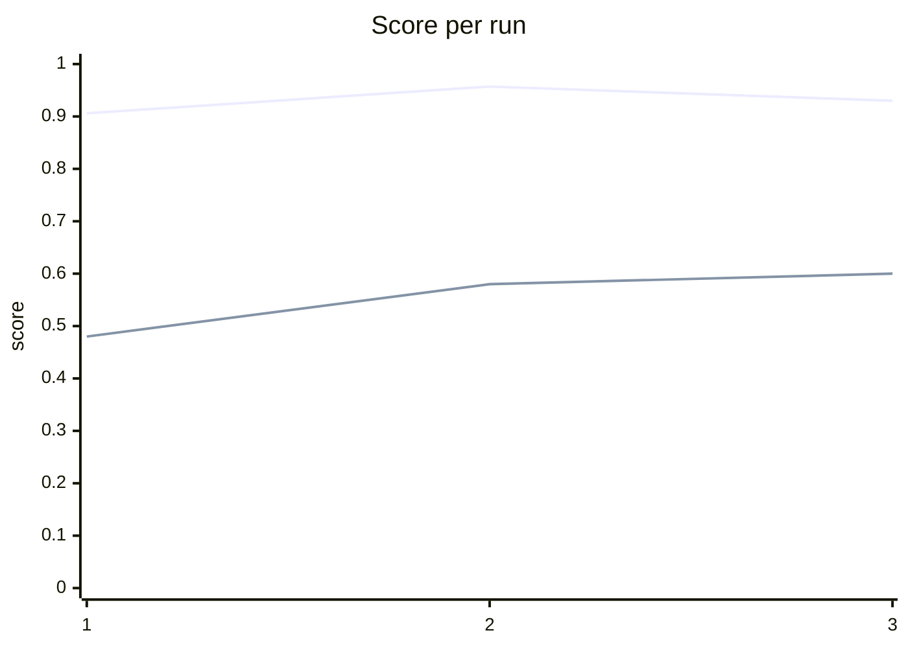

# Improvement over runs

All 3 runs score the same full dataset.

Lines: average cost-weighted score (first), exact-match rate (second).

| Run | Config | Avg score | Exact match | Wrongful denials | Status | Changes tested |
|---|---|---|---|---|---|---|
| 1 | v0 | 0.906 | 0.48 | 4 | baseline | — |
| 2 | v1 | 0.957 | 0.58 | 0 | kept | add [coverage/all] When a claim involves possible business use of a personal auto policy (delivery, rideshare, or any paid transport), never deny or fast-track. Route to coverage review with human sign-off. ; add [coverage/all] When a policy cancellation or driver exclusion may be invalid due to missing notice or missing signature, do not deny or pay. Route to coverage review with human sign-off. ; add [coverage/all] When a claim is reported more than 30 days after the loss, do not deny or pay. Route to coverage review with human sign-off before any payment decision. |
| 3 | v2 | 0.93 | 0.6 | 2 | rolled back | add [decider/all] When a claim is not at fault and subrogation is pursued, do not apply the insured's deductible. The deductible must be included in the subrogation demand and refunded to the insured from the recovery. ; add [decider/all] When a claim involves no injuries and clear liability, route to fast-track. Do not route to subrogation unless the insured is not at fault. ; add [fraud/all] When a claim involves a rear-end collision where the lead vehicle braked suddenly with no apparent reason and multiple occupants report similar injuries treated at the same clinic, refer to SIU as a suspected staged accident. Do not concede 100% fault without SIU review. |

## Score by category (gold route)

| Category | run 1 | run 2 | run 3 |
|---|---|---|---|
| adjuster | 0.942 | 0.95 | 0.917 |
| coverage_review | 0.593 | 0.893 | 0.779 |
| deny | 1.0 | 1.0 | 1.0 |
| fast_track | 0.992 | 0.992 | 0.997 |
| siu | 0.812 | 0.912 | 0.738 |
| subrogation | 0.925 | 0.925 | 0.956 |
